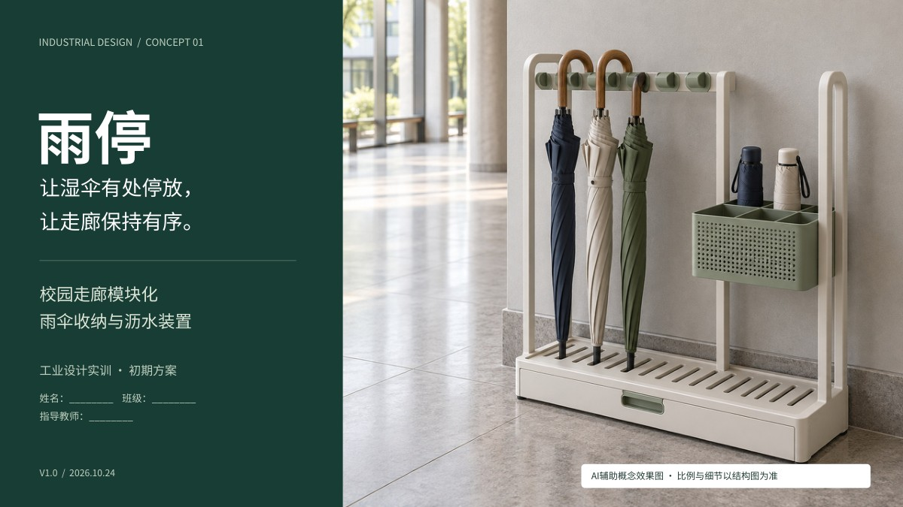

# 雨停 YUTING

校园走廊模块化雨伞收纳与沥水装置 · 工业设计实训初期方案 V1.0

> 让湿伞有处停放，让走廊保持有序。

## 文件下载

- [图文方案 PDF（22页）](yuting/yuting-concept.pdf)
- [可编辑汇报 PPTX（22页）](yuting/yuting-presentation.pptx)
- [可编辑设计说明书 DOCX](yuting/yuting-design-report.docx)
- [完整资料包 ZIP（PDF、PPTX、DOCX及阅读说明）](yuting/yuting-design-package.zip)

打开文件后点击 **Download raw file / 下载原始文件** 保存；ZIP文件可直接下载。

## 方案内容

场景分析、使用旅程、调研计划、现有结构类型比较、需求转译、三种概念方案及筛选、推荐方案效果图、初步三视图、结构拆解、限位与连接细节、沥水与清洁流程、材料与人机、空间布置、样机预算、测试计划、推进安排及现场记录附件。

推荐结构：长伞分位限位、折叠伞浅篮收纳、底部集中接水。单模块暂设6个长伞位与4个短伞位，可并排连接；后部防倾倒结构需经点位与工程验证。

## 使用说明

- 本资料属于初期概念方案，未开展实地调研或原型测试。
- 所有尺寸、容量、成本、评价分数及试验目标均为设计假设，须后续测量验证。
- 产品效果图为AI辅助生成；结构示意为本方案绘制，不替代工程CAD。
- PPT与Word中的文字、表格可编辑；PPT线图为可编辑形状，效果图为嵌入位图。
- 建议使用微软雅黑编辑。PDF内嵌中文字体，审阅与打印优先使用PDF。
- 规范仅提供核查线索，尚未进行通行、无障碍、消防及结构合规审查。

整理日期：2026年10月24日。
