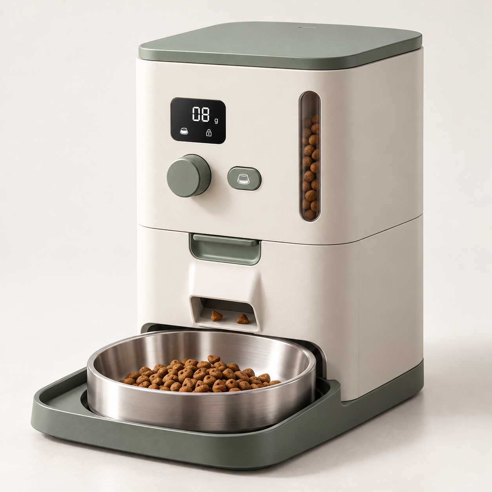
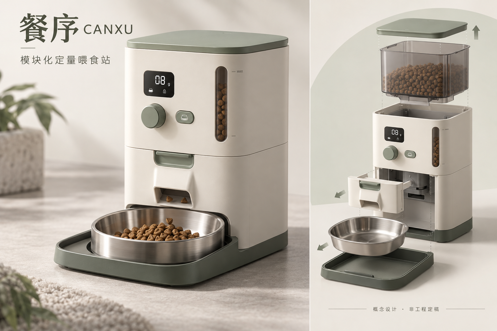
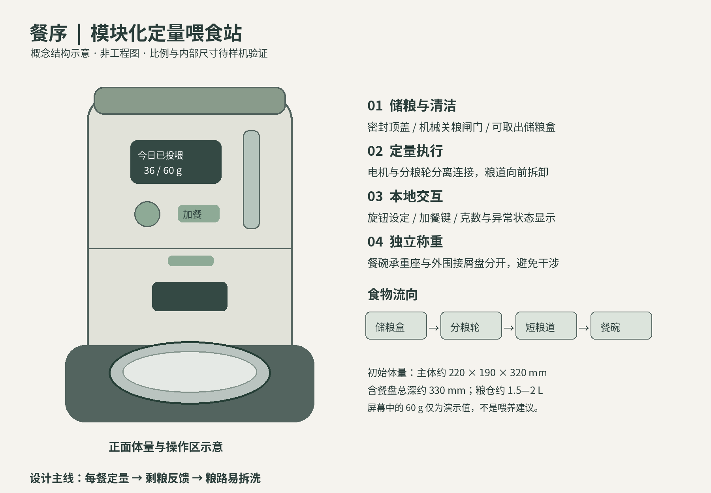

# 餐序 CANXU｜毕业设计概念资料包

面向小户型养猫家庭的易清洁定量喂食产品设计。

**建议先看整机图，再打开图文方案；需要全部文件时下载下方ZIP。** 图片已作为实际PNG文件上传，支持打开原图及本地保存。

## 快速打开

- [整套资料 ZIP](餐序_毕业设计概念资料包_V1.1.zip)
- [11页图文设计方案 PDF](01_餐序_毕业设计深化方案_图文版.pdf)
- [图文设计方案 Word](01_餐序_毕业设计深化方案_图文版.docx)
- [第一阶段作业修订稿 PDF](02_第一阶段作业_宠物喂食方向修订稿.pdf)
- [第一阶段作业修订稿 Word](02_第一阶段作业_宠物喂食方向修订稿.docx)
- [调研与验证记录模板 PDF](03_调研与验证记录模板.pdf)
- [调研与验证记录模板 Word](03_调研与验证记录模板.docx)

## 整机外观

[打开整机原图](产品图片/01_整机外观概念图.png)

## 拆洗与功能布局

## 方案主线

1. **加餐联动**：临时加餐可计入每日计划，并清楚显示后续份量变化。
2. **剩粮反馈**：根据稳定后的碗内余粮，按预设规则补粮或暂停提醒。
3. **粮路易拆洗**：关粮后拆出储粮盒、分粮组件与短粮道，电子件保留在干区。

## 内容状态

本资料包为概念深化 V1.1，包含设计任务书、图文方案、独立课程修订稿、记录模板及三张图片。概念图于2026年10月25日形成，资料于2026年10月26日上传。

两张效果图为AI辅助概念表达，不作为加工或装配图。功能示意和初始尺寸均需建模与样机验证。课程修订稿已标出真实案例、文献核查、访谈和实验的待完成内容；不包含虚构调研结果、导师确认或已验证的性能结论。

如GitHub的PDF预览加载失败，请下载PDF后在本地阅读。点击文件页的“Download raw file”可保存原文件；ZIP文件也可以直接下载后解压。

文件完整性校验见 [SHA256SUMS.txt](SHA256SUMS.txt)，使用说明见 [先读我.txt](先读我.txt)。
