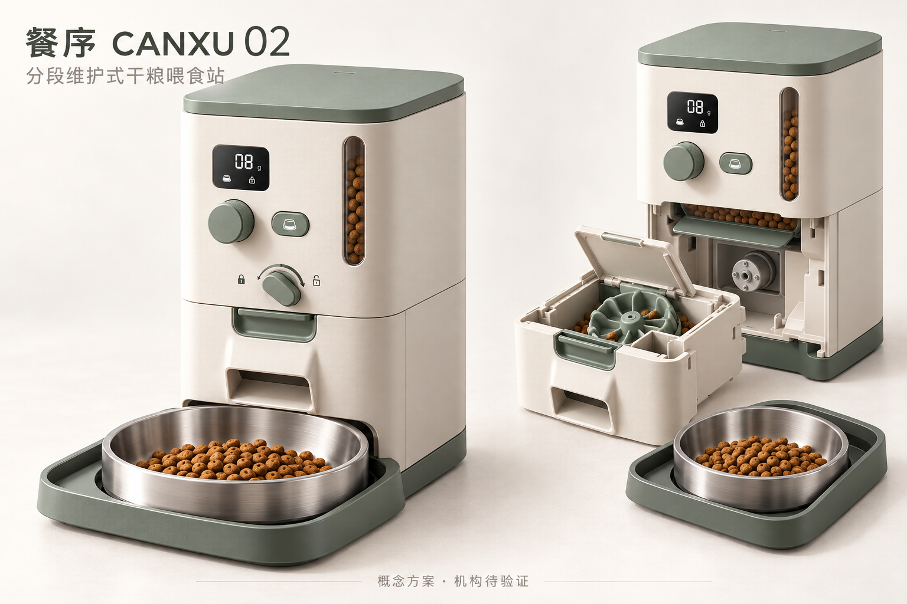

# 餐序 CANXU V2｜市场分析与亮点深化

依据8款具名产品和17条官方产品/支持来源，重新界定毕业设计特点。研究日期：2026年10月26日。

## 下载与阅读

- [整套V2资料 ZIP](餐序_V2_市场分析与亮点深化资料包.zip)
- [市场分析与产品亮点报告 PDF](01_市场竞品分析与产品亮点_V2.pdf)
- [报告可编辑 Word](01_市场竞品分析与产品亮点_V2.docx)
- [第一阶段作业市场依据补充版 PDF](02_第一阶段作业_市场依据补充版_V2.pdf)
- [第一阶段作业市场依据补充版 Word](02_第一阶段作业_市场依据补充版_V2.docx)
- [8款竞品对照 CSV](04_八款竞品对比与来源.csv)
- [官方来源与证据边界](05_官方来源与证据边界.md)
- [在线阅读完整分析](06_市场分析与V2设计全文.md)

## V2概念图

[打开产品原图](03_餐序V2_产品与分段维护概念图.png)

## 本次方案的三个重点

1. **带粮分段维护**：先关闭储粮仓底部闸门，再前抽下游分粮/短粮道模组。仓内保留余粮时清理下游；仓体和闸门上游仍需清空清洗。
2. **洗后明确复位**：确认充分干燥、模组/碗到位、空碗去皮；拨杆回运行位且确认闸门全开后，恢复下一次有效计划。漏餐不集中补发。
3. **本地解释加餐变更**：操作前显示临时加餐会怎样改变后续餐次；外部同种干粮登记与设备任务分开。计划量、估计执行量与稳定余粮明确区分。

## 市场研究带来的修改

小米2、Granary 2等已提供称重或余粮管理，多款已有可拆清洁与离线计划。餐序将这些列为基础能力，把设计投入到维护任务、机械顺序和本地解释。具体对照与官方链接均在报告中。

本包为概念深化研究，不含虚构访谈或实验结果。厂家参数为宣称，V2图为AI辅助概念表达，不能作为工程装配图或专利新颖性证明。后续需用同条件竞品实操、用户任务和结构台架验证改进。

旧版材料保留在上级目录供版本追溯。若PDF预览空白，请下载后在本地打开；PNG可直接打开原图，Word可编辑，CSV采用UTF-8 BOM以便中文表格软件读取。
